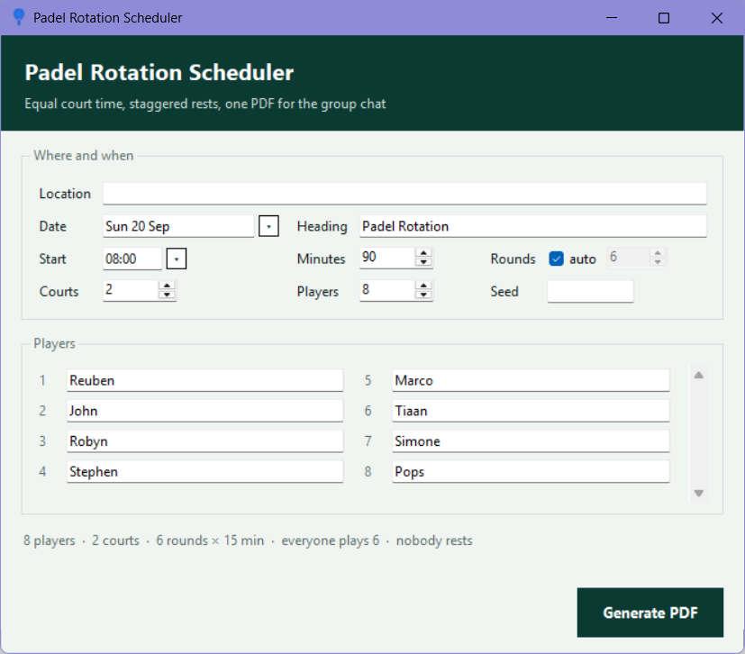
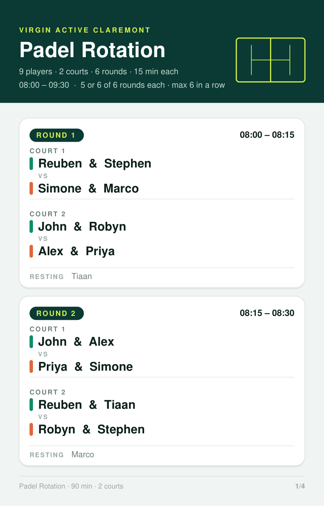

# Padel Rotation

Builds a fair rotation for a padel session and exports it as a phone-shaped PDF
you can drop straight into a WhatsApp group.

Give it the courts you have booked, the people who are coming and how long you
have, and it works out who plays whom, on which court, in which round — so that
everyone gets the same court time and nobody plays four in a row and then sits
out the rest of the morning.



...and what it produces:



## The web app

`web/` is a phone-first version that runs entirely in the browser (Vite + Preact,
no server), hosted on Vercel. It has the same form, rules and messages as the
window, the same scheduler (ported line for line), and the PDF comes out in the
same layout as `padel.py`'s: same text positions, page sizes and pixels. Generate
hands the PDF to the phone's share sheet (WhatsApp), or downloads it on a desktop.
Seeds only rebuild rotations made by the web app, not ones from the exe.

It also keeps score for an Americano: after Generate, or after picking a PDF made
by either app, it shows the schedule, takes each match's points (e.g. 14–11),
keeps a leaderboard and shares the results to WhatsApp. Tap a name to fix its
spelling or bring on a substitute from a given round.

Ranking: total points, then matches won, then point difference. When people have
played different numbers of games it ranks per game instead. A draw counts as half a win.
The current session is saved in the browser, so closing the tab loses nothing.

```
cd web
npm install
npm run dev       # http://localhost:5173
npm test
```

Vercel: import the repo, set **Root Directory** to `web` (framework: Vite).

## Running it

**The app:** double-click `Padel Scheduler.exe` (in this repo). Nothing to install.

**From source:** needs Python 3.11+ and reportlab.

```
pip install reportlab
python padel_gui.py          # the window
python padel.py --help       # the command line
```

`Run from source.bat` does the same thing on Windows without a console window.

## The window

Fill in where and when you are playing, set the courts and the number of
players, then type a name in each box. Names and venues you have used before
are suggested as you type. The **Date** box has a calendar next to it and
**Start** a pair of wheels for the hour and the minutes, if you would rather
pick than type — both boxes still take typing (`Sat 20 Sep`, `7:30pm`). A line
under the roster tells you what you are about to get, and a warning stops you
if the roster cannot fill the courts:

```
2 courts need at least 8 players, got 7 - add 1 more.
```

Click **Generate PDF**, choose where to save it, and it opens. The save box
opens on the folder you used last time, falling back to the desktop.

Settings are remembered in `padel_history.json` next to the app.

## The command line

```
python padel.py --courts 2 --players "Ann,Ben,Cara,Dan,Eve,Finn,Gus,Hana" \
                --start 8:00 --minutes 90 --location "Virgin Active" --open
```

| option | what it does |
|---|---|
| `--players` / `--players-file` | names, comma separated or one per line |
| `--courts` | courts booked (default 1) |
| `--minutes` | session length (default 90) |
| `--rounds` | override the round count |
| `--start` | `8:00`, `19:00` or `7:30pm` — omit for relative times |
| `--location`, `--date`, `--title` | shown on the PDF |
| `--seed` | reuse a printed seed to rebuild the same rotation |
| `-o`, `--open`, `--quiet` | output path, open when done, skip the console table |

## How the rotation is worked out

**Round count.** It looks for a number of rounds where everyone plays exactly
the same number of games *and* the rounds land between 12 and 18 minutes. If no
such number exists, round length wins and one or two people play one game more —
the PDF says so rather than pretending otherwise.

**Who is on court.** Everyone gets a quota of games, then simulated annealing
shuffles players between rounds — keeping quotas and round sizes intact — against
a cost that punishes runs longer than two rounds on or off, and gently pulls each
player's games towards an even spread across the session.

**Which court, and who partners whom.** A second annealing pass seats the players
on courts and picks the teams, scoring the squares of how often each pair has
partnered, opposed each other, and used each court. Squaring is what spreads
things out: a third meeting costs much more than a first.

Some rotations are impossible and the app is honest about them. Five players on
one court means whoever rests in round one then plays every remaining round.
Eight players on two courts means nobody ever rests.

## Rebuilding the executable

```
pip install pyinstaller
pyinstaller --noconfirm --clean --onefile --windowed --name "Padel Scheduler" \
            --icon assets/icon.ico --add-data "assets/icon.ico;assets" \
            --add-data "assets/icon.png;assets" --hidden-import padel padel_gui.py
```

The binary lands in `dist/`; move it to the project root to replace the one in
this repo. It is committed here so you can download and run it without Python
(it is ~30 MB, so each rebuild you commit adds that much to the repo history).

## Layout

| file | |
|---|---|
| `padel.py` | scheduling and PDF rendering, plus the command line |
| `padel_gui.py` | the tkinter window |
| `assets/` | the app icon: `icon.ico` for Windows, `icon.png` elsewhere, `icon-source.png` as drawn |
| `Run from source.bat` | Windows launcher for the source version |
